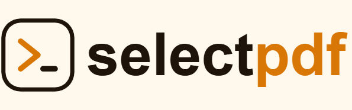

<p align="center">
  <a href="https://selectpdf.com">
    
  </a>
</p>

<h1 align="center">SelectPdf — AI Tools</h1>

<p align="center">
  Skills that teach AI coding assistants (Claude Code, and any agent that reads
  <a href="https://docs.claude.com/en/docs/claude-code/skills">Agent Skills</a>) how to use
  <a href="https://selectpdf.com">SelectPdf</a> correctly — accurate APIs, real code, both C# and VB.NET.
</p>

---

## What's in here

This repository is the home for all SelectPdf AI tooling. It is packaged as a single Claude Code
plugin, **`selectpdf`**, exposed through a plugin marketplace.

### Plugin: `selectpdf`

| Skill | Covers | Package |
|---|---|---|
| **`selectpdf-lib-universal-net`** | **SelectPdf.Universal**, the cross-platform commercial library for Windows, Linux (x64, ARM64), macOS on Apple Silicon and Docker, or anywhere through the remote engine container — HTML→PDF (sync and async) with tables of contents and fillable form fields, Word to PDF, build/edit PDFs, merge, AcroForms, digital signatures (PFX, certificate store, PKCS#11 tokens and HSMs, long-term validation) and validation, redaction, encryption including AES-GCM, PDF→text/image, PDF/UA-1 and PDF/UA-2, PDF/A-1a to PDF/A-4, ZUGFeRD / Factur-X. | [`SelectPdf.Universal`](https://www.nuget.org/packages/SelectPdf.Universal/) + `SelectPdf.Universal.Native.<rid>`, or one `SelectPdf.Universal.<Platform>` package |
| **`selectpdf-lib-htmltopdf-universal-net`** | The free cross-platform **Community Edition** — HTML→PDF only, 5 pages per document. | [`SelectPdf.HtmlToPdf.Universal`](https://www.nuget.org/packages/SelectPdf.HtmlToPdf.Universal/) + `SelectPdf.Universal.Native.<rid>`, or one `SelectPdf.HtmlToPdf.<Platform>` package |
| **`selectpdf-lib-net`** | The classic **commercial** Select.Pdf library for Windows — HTML→PDF, build/edit PDFs, merge/split, AcroForms, digital signatures, encryption, PDF→text/image, accessible tagged PDF/UA-1, PDF/A-3, ZUGFeRD / Factur-X. | [`Select.Pdf`](https://www.nuget.org/packages/Select.Pdf/) / [`Select.Pdf.NetCore`](https://www.nuget.org/packages/Select.Pdf.NetCore/) |
| **`selectpdf-lib-htmltopdf-net`** | The classic free **Community Edition** for Windows — HTML→PDF only, 5 pages per document. | [`Select.HtmlToPdf`](https://www.nuget.org/packages/Select.HtmlToPdf/) / [`Select.HtmlToPdf.NetCore`](https://www.nuget.org/packages/Select.HtmlToPdf.NetCore/) |

Each skill tells the assistant how to recognise its package and points to the right sibling skill, so a
project on `SelectPdf.Universal` (namespace `SelectPdf.Universal`) never gets classic-only code, and a request
for Linux, macOS or Docker is routed to the Universal skills.

Every skill ships a lean `SKILL.md` (quickstart, decision routing, gotchas) plus topic-by-topic
reference files that load on demand. All code samples are provided in **C# and VB.NET**.

> **Naming.** Library skills are suffixed `-net` because the SelectPdf .NET library is .NET-only.
> Skills for the SelectPdf **online REST API** (which has clients in several languages) will live in
> this same plugin under the `selectpdf-api-*` family — e.g. `selectpdf-api-net`, `selectpdf-api-php`.

## Install (Claude Code)

```text
/plugin marketplace add selectpdf/ai-tools
/plugin install selectpdf@selectpdf
```

Then the right skill activates automatically when you ask Claude to generate or manipulate PDFs in a
.NET project. You can also copy any `skills/<name>/` folder into your project's `.claude/skills/`
directory to use it without the plugin.

## Other assistants — Cursor, GitHub Copilot, Codex

The same knowledge is available for other AI coding assistants under
[`integrations/`](integrations/): condensed, self-contained guides in each tool's native format
(Cursor `.mdc` rules, Copilot `.instructions.md`, Codex `AGENTS.md`) that link back to the reference
files here for depth. See [`integrations/README.md`](integrations/README.md) for where to drop each one.

## Versioning

Content tracks **SelectPdf v26.5**. API signatures and feature availability are taken from the shipped SDK
reference, official samples and SDK source. The Universal skills are converted from the shipped v26.5 help
topics, and every C# and VB.NET sample in them was compiled against the 26.5.0 NuGet packages.

## Resources

- 📖 SelectPdf.Universal docs — https://selectpdf.com/pdf-library/ (free edition: https://selectpdf.com/html-to-pdf/docs/)
- 📖 Classic library docs — https://selectpdf.com/pdf-library-classic/ (free edition: https://selectpdf.com/html-to-pdf/docs-classic/)
- 🧪 Live demos — https://selectpdf.com/demo-universal/ (Universal), https://selectpdf.com/demo/ (classic)
- 🐧 Cross-platform library — https://selectpdf.com/pdf-library-cross-platform/
- ⬇️ Downloads & free trial — https://selectpdf.com/downloads/
- 📦 Library source & README — https://github.com/selectpdf/pdf-library-for-net

---

<p align="center">© SelectPdf — <a href="https://selectpdf.com">selectpdf.com</a></p>
